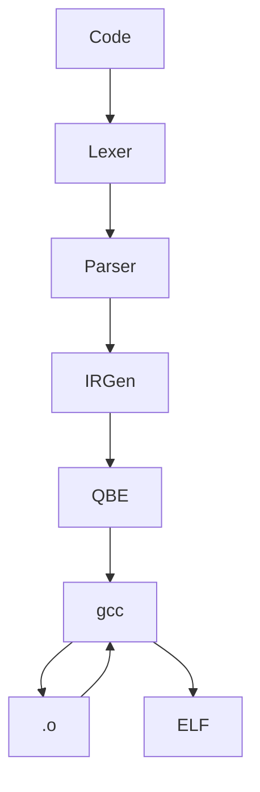

# B

A compiler for the **B** (like) language with a couple of syntax and semantic deviations from the original spec. This isnt exactly the historical B, but I didn't know what else to name this. Feel free to drop your suggestions if you have any!.

## Build and Run
Run the following commands at the same level of the .cabal file.

### Build
```
cabal build
```

The path to built executable can be found via
```
cabal list-bin exe:B
```

### Run
Build and run directly via
``` 
cabal run B.cabal -- [flags] [<file>.b] -o <file>
```

## Compilation and Linking
For linking, we directly invoke `gcc`. Full static linking is not supported yet!

Input files can be of the types:
| Extension | Type |
|---|---|
| `.b` | B source code |
| `.s` | asm source code |
| `.ssa` | QBE IR source code |
| `.o` | object file |

```
$ ./B --help
./B [flags] [<file>.(b|o|s|ssa)] -o <file>

--help - Display this output.
--keep-ir - Keep the intermediate representation file.
--keep-asm - Keep the assembly file.
--keep-all - Keep every generated file.
-c - Only compile (No linking)
-o <file_name> - Specify output file name
```

## Pipeline


## Features Implemented

### Functions
```
main(argc, argv) {
  return 0;
}
```

### Function calls
```
putnum(num) {
  // Number printing logic.
  // Function definition given below if you want to run the examples.
}

main() {
  extrn putnum;         // External(Global) symbol declaration.

  putnum(67);

  return 0;
}
```

### Arithmetic operations
Floating point numbers are not supported. Division operator therefore returns the result as rounded down integer. Rest of the operators do exactly what you expect them to do.

### Comparision operations (Deviation from historical B)

Since B does not have distinct signed and unsigned integer types, comparison operators cannot infer the intended interpretation of their operands from their types.

We therefore need an additional operator to support both signed and unsigned comparisons.

This implementation keeps the default comparison as signed and introduces separate operators for unsigned comparisons.

A signed relational operator can be converted to an unsigned relational operator by prefixing the character `u`.

| Signed | Unsigned |
|---|---|
| `<` | `u<` |
| `>` | `u>` |
| `<=` | `u<=` |
| `>=` | `u>=` |

Equality (`==`) and inequality (`!=`) remain unchanged because their results are independent of signedness.

The distinction is purely in how the underlying bit patterns are interpreted. No conversion of the operands is necessary; the compiler simply emits the appropriate signed or unsigned comparison.
```
main() {
  extrn putnum;

  // Negative numbers are naturally stored as 2's complement (wrap around)

  putnum(-1 < 0);      // prints 1 (True)
  putnum(-1 u< 0);     // prints 0 (False)

  return 0;
}
```

### Control-Flow

#### if-else
```
main() {
    extrn putstr;     

    auto x = 10;     // Local variable declaraion; sizeof(x) = 1 word

    if (x > 10) {
        putstr("Greater than 10");
    } else if (x == 10) {
        putstr("Equal to 10");
    } else {
        putstr("Less than 10");
    }

    return 0;
}
```

#### Loops
```
main() {
    extrn putnum, putchar;

    auto i = 0;

    while (i < 10) {
        if (i == 3)
            continue;

        if (i == 7)
            break;

        putnum(i);
        putchar('|');

        i += 1;
    }

    return 0;
}
```

### Arrays and pointer arithmetic (Deviation from historical B)
**Note: Only 1D array declarations are supported for now!**

Array access and pointer arithmetic are a bit weird in B on machines that are not word-addressable.

Languages with explicit pointer types know when and how to scale offsets used with pointers.

```c
int *p;
p + 1;
```

`p+1` gets translated conceptually to `p + 1 * sizeof(int)`. The same applies to array subscripting: `p[1]` is equivalent to `*(p + 1 * sizeof(int))`.

In B, where everything essentially has one type, the compiler cannot determine from an ordinary arithmetic expression like `p+1` whether `p` represents a memory address or just an ordinary integer. Consequently, it cannot automatically decide whether the second operand should be scaled.

This is a non-issue on word-addressable machines, since consecutive memory locations differ by exactly one word. Adding 1 to a word address takes you to the next word.

However, on byte-addressable machines, native addresses advance in units of bytes, not words. If we represent B pointers using native byte addresses, adding 1 advances by one byte rather than one B cell.

One way to address this is to special-case array subscripting. The compiler can treat the left operand as the base address and scale the right operand by the size of a B cell.

For example:

```c
arr[i] == *(arr + i * B_CELL_BYTES)
```

Here, `B_CELL_BYTES = widthof(word) / widthof(cchar)`.

Ordinary arithmetic operations remain unchanged. Thus, `arr + i` does not automatically scale `i`; the programmer is responsible for scaling offsets when performing pointer arithmetic explicitly.

This is an implementation-specific compromise. Unlike original B, where `arr[i]` is equivalent to `*(arr+i)` and the operands can be swapped, this implementation treats the left operand of `[]` as the base address and the right operand as the offset. Consequently, `arr[i]` and `i[arr]` are not equivalent.

Another way to solve this, which is much more correct in my opinion, is to retain B's original word-addressed pointer representation. Instead of storing native byte addresses, pointers would store word indices. Before dereferencing a pointer, the compiler would convert the word address into a native byte address.

However, this means every interaction with the underlying system must handle address conversion. For example, pointers returned by `malloc()` would need to be converted into B word addresses, while pointers passed to `free()`, `read()`, `write()`, etc. would need to be converted back into native byte addresses.

We would effectively need our own compatibility layer (`libb.so`) to wrap libc and system interfaces and handle these conversions.

This approach preserves B's original pointer arithmetic and subscripting semantics, but introduces additional complexity at system interfaces.

For this implementation, I chose the easier route of representing pointers as native byte addresses and keeping compatibility with libc, at the cost of deviating from B's original pointer arithmetic semantics.

```
main() {
    extrn putnum;
    
    auto arr1[5];                 // Uninitialized array.
    auto arr2[5] = {1,2,3,4,5};   // Fully initialized array.
    auto arr3[5] = {1};           // Partially initialized array. Remaining elements are set to 0.

    auto i = 0;
    auto sum = 0;

    while(i < 5) {
      sum += arr3[i++];
    }

    putnum(sum);

    return 0;
    
}
```

### Addresses and de-referencing
```
main() {
    extrn putnum;

    auto a = 67;
    auto ptr_a = &a;

    putnum(*ptr_a);

    return 0;
}
```

### Strings and Characters (Deviation from historical B)
'\\' is used instead of '*' for escaping characters.

strings are contiguously packed and are NULL terminated. 
```
putstr(str) {
  extrn putchar;

  auto i = 0;

  while(str[i] != 0) {
    putchar(str[i++]);
  }
}

main() {
    extrn putstr, putchar;

    auto greet = "Hello World";
    auto new_line = '\n';

    putnum(greet);
    putchar(new_line);

    return 0;
}
```

### Bit operations
```
main() {
    extrn putnum, putchar;

    auto i = 2;

    putnum(i);
    putchar('\n');

    i <<= 1;              // left shift
    putnum(i);
    putchar('\n');
    
    i >>= 1;              // right shift
    putnum(i);
    putchar('\n');


    i &= 2;               // AND
    putnum(i);
    putchar('\n');


    i |= 2;               // OR
    putnum(i);
    putchar('\n');

    i ^= 1;               // XOR
    putnum(i);
    putchar('\n');

    return 0;
}
```

### Global Variables
Global variables need to be mandatorily initialized for now.
```
counter = 0;
arr[3] = {};

increment() {
  extrn counter;

  ++counter;
}

populate() {
  extrn arr, counter;
  extrn increment;

  auto i = 0;

  while(i < 3) {
    arr[i++] = counter;
    increment();
  }
}

main() {
  extrn putnum, putstr, counter;
  extrn populate, arr;

  populate();

  auto i = 0;

  while(i < 3) {
    putnum(arr[i++]);
    putstr("|");
  }

  putstr("\n");
  putnum(counter);
  putstr("\n");

  return 0;
}
```

## Examples

### Recursion
```
fib(n) {
  extrn fib;

  if(n == 0)
    return 0;
  
  if(n == 1)
    return 1;
  
  return fib(n-1) + fib(n-2);
}

putnum(n) {
    extrn putchar, putnum;

    if (n < 0) {
        putchar('-');
        n = -n;
    }

    if (n >= 10)
        putnum(n / 10);

    putchar('0' + n % 10);
}

main() {
  extrn putnum, putchar, fib;
  
  auto i = 0;

  while(i < 10) {
    putnum(fib(i++));
    putchar('|');
  }

  putchar('\n');
  return 0;
}
```

### Currying (type shi)
```
ma_putchar() {
  extrn putchar;
  return &putchar;
}

main() {
  extrn ma_putchar;

  ma_putchar()('A');
  ma_putchar()('\n');

  return 0;
}
```
